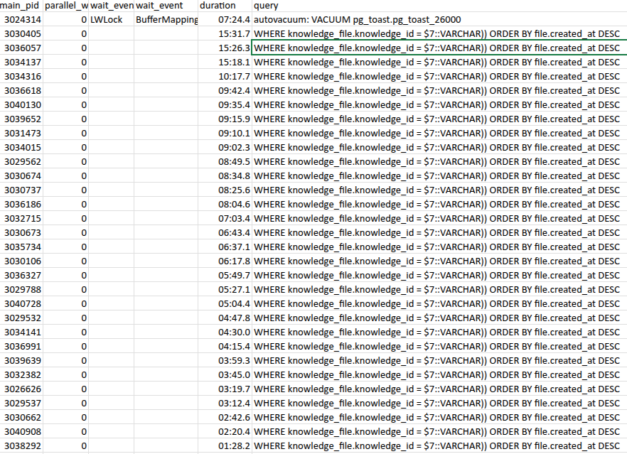
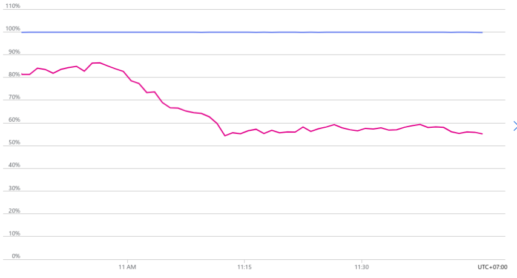
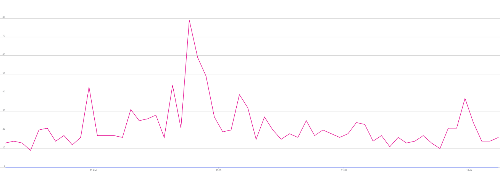
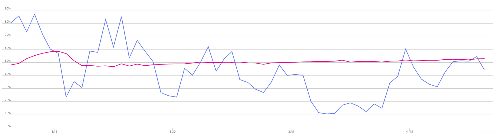

---

title: Surviving a 100% CPU Database Meltdown in Open WebUI - Fixing a Hidden Full Table Scan
published: 2026-07-06
tags: ["SRE"]
---

We host a beta version of an open-source tool called Open WebUI at an enterprise scale. We have over 1,000 daily users, hitting 500+ concurrent users at peak times.

Recently, I was pressured by the business side to upgrade to a newer version.  
 As I always say, there are some production issues that are simply too costly or impossible to catch in DEV/UAT environments. This was one of them.

A day or two after the upgrade, our production PostgreSQL database was suddenly pinned at 100% CPU.  
All actions on the web UI became randomly sluggish with wildly inconsistent loading times.

Because we have a managed Postgres instance, I checked the query insights on our portal.  
I found this query taking an estimated 1-2 hours to execute:
```
SELECT public.file.id, public.file.user_id, ... FROM public.file WHERE 
CAST(((meta -> $1) ->> $2) AS VARCHAR) = $3 AND CAST((data 
->> $4) AS VARCHAR) IN ($5,$6) AND id NOT IN (SELECT file_id FROM 
knowledge_file WHERE knowledge_id = $7)
```
This perfectly matched an active GitHub Issue [(#25717)](https://github.com/open-webui/open-webui/issues/25717). Long story short: there is a specific endpoint that triggers a knowledge-management query, resulting in a massive full table scan on unstructured JSON columns.

I ran a query to check for active, blocking queries:
```
SELECT 
    coalesce(leader_pid, pid) AS main_pid,
    COUNT(pid) - 1 AS parallel_workers_hijacked,
    wait_event_type,
    wait_event,
    age(clock_timestamp(), MIN(query_start)) AS duration,
    query
FROM pg_stat_activity
WHERE state = 'active' 
  AND pid <> pg_backend_pid()
GROUP BY coalesce(leader_pid, pid), wait_event_type, wait_event, query
ORDER BY COUNT(pid) DESC, duration DESC;

```

The results confirmed that multiple instances of that exact SELECT file.id... query were actively spinning our CPU up to 100%.



Here is my step-by-step action plan to survive the spike and permanently fix the bug.
## 1. Kill all stuck queries
To get immediate relief, I terminated the blocking backends:
```
SELECT pg_terminate_backend(pid)
FROM pg_stat_activity
WHERE query ILIKE '%SELECT file.id, file.user_id%'
  AND query ILIKE '%status%'
  AND state = 'active'
  AND age(clock_timestamp(), query_start) > interval '5 minutes';
  ```
With monitoring, I confirmed the CPU immediately dropped from 100% to normal levels. That proved these specific query processes were the culprit.

From

To

## 2. Create a pg_cron to actively eliminate this query
To keep the database alive while I worked on a permanent fix, I scheduled a cron job to actively eliminate this query if it hung for more than 1 minute:
```
SELECT cron.schedule(
    'kill-stuck-openwebui-queries',
    '*/2 * * * *',
    $$
    SELECT count(pg_terminate_backend(pid))
    FROM pg_stat_activity
    WHERE query ILIKE '%SELECT file.id, file.user_id%'
      AND query ILIKE '%status%'
      AND state = 'active'
      AND pid <> pg_backend_pid() -- Never kill the job itself
      AND age(clock_timestamp(), query_start) > interval '1 minute';
    $$
);
```

## 3. Create Index for file table
The query was bottlenecking because it was searching inside JSON blobs without an index. I started by indexing just the knowledge_id:
```
CREATE INDEX CONCURRENTLY idx_file_pending_knowledge
ON public.file (((meta->'data'->>'knowledge_id')::uuid))
WHERE (data->>'status') IN ('pending','processing');
```

I tested it with an EXPLAIN (ANALYZE, BUFFERS) using a real UUID :
```
EXPLAIN (ANALYZE, BUFFERS)
SELECT id FROM public.file 
WHERE (meta->'data'->>'knowledge_id') = '<-------UUID------->'
  AND (data->>'status') = 'pending';
```
The result was still far too slow (about 40 seconds)
```
Bitmap Heap Scan on file  (cost=6.39..6740.81 rows=11 width=37) (actual time=40697.806..40697.807 rows=0 loops=1)
  Recheck Cond: ((data ->> 'status'::text) = ANY ('{pending,processing}'::text[]))
  Filter: (((data ->> 'status'::text) = 'pending'::text) AND (((meta -> 'data'::text) ->> 'knowledge_id'::text) = '<-------UUID------->'::text))
  Rows Removed by Filter: 448
  Heap Blocks: exact=472
  Buffers: shared hit=895 read=124287
  I/O Timings: shared read=6494.249
  ->  Bitmap Index Scan on idx_file_pending_knowledge  (cost=0.00..6.39 rows=4386 width=0) (actual time=0.213..0.214 rows=963 loops=1)
        Buffers: shared hit=1
Planning:
  Buffers: shared hit=194
Planning Time: 1.151 ms
Execution Time:** 40697.900 ms**
```

Notice the 124287 disk reads. The database still had to load massive amounts of data into memory just to filter the status.

## 4. The Kill Shot: The Composite Partial Index
```
CREATE INDEX CONCURRENTLY idx_file_pending_knowledge_composite 
ON public.file (
    (data->>'status'), 
    ((meta->'data'->>'knowledge_id')) 
) WHERE (data->>'status') IN ('pending', 'processing');
```

The result was instantly a game-changer. The execution time dropped to 0.064ms.
```
Index Scan using idx_file_pending_knowledge_composite on file  (cost=0.15..24.37 rows=11 width=37) (actual time=0.013..0.013 rows=0 loops=1)
  Index Cond: (((data ->> 'status'::text) = 'pending'::text) AND (((meta -> 'data'::text) ->> 'knowledge_id'::text) = '<-------UUID------->'::text))
  Buffers: shared hit=1
Planning:
  Buffers: shared hit=17
Planning Time: 0.359 ms
Execution Time: **0.064 ms**
```
## The End Result
The application is now highly responsive again, and the database CPU is normal again.


While this composite index permanently solved the issue, I still consider this a symptom of a larger problem. When you run beta, open-source software, you have to be prepared for unoptimized queries. However, a blind spot this large indicates that their test suite—despite any claims of being "enterprise-ready" is clearly not being tested against datasets that resemble real-world production scale.

A full table scan on unstructured JSON might slip by silently when testing with 50 documents on a developer's laptop, but it will bring a server to its knees the moment you hit a real user load.

Open WebUI is a powerful tool, but incidents like this lower my inherent trust in their database architecture. If you're running it in production, be prepared to get your hands dirty and self-patch.

